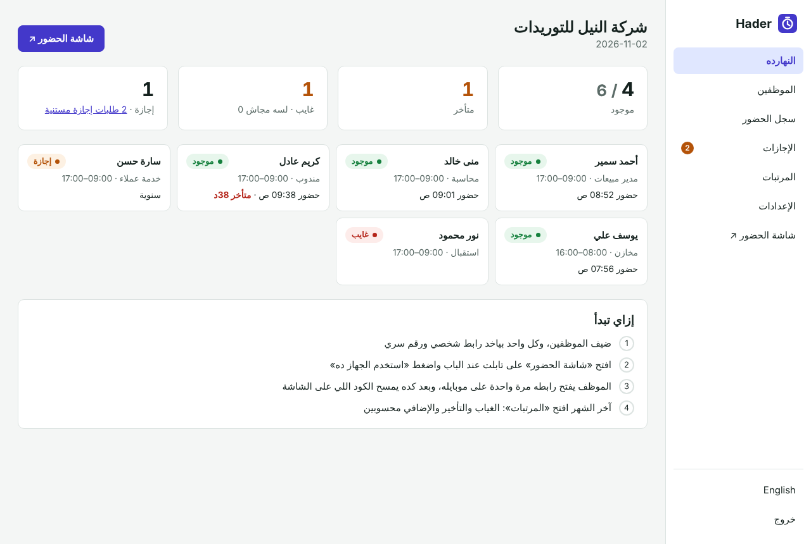
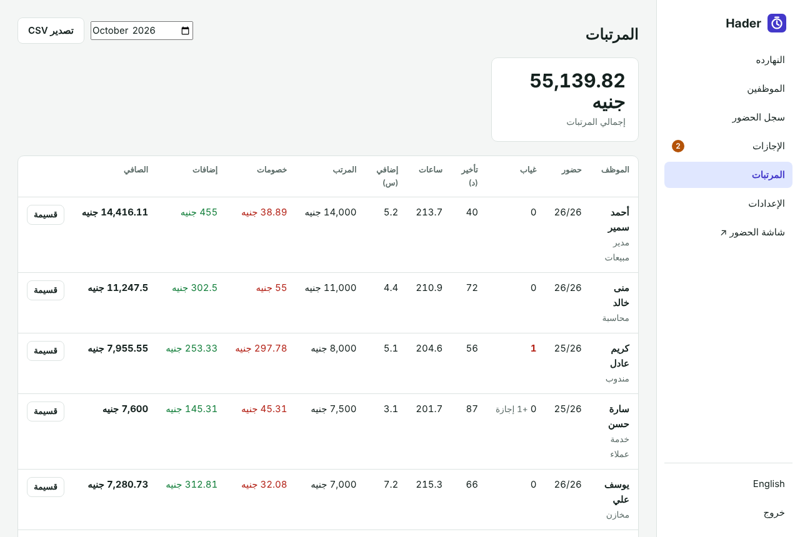

<div align="center">

# Hader · حاضر

**Staff attendance and payroll for small businesses: shops, clinics, restaurants, offices and workshops.**
Employees check in by scanning a QR code on a tablet at the door. The code changes every minute, so a photo sent to a friend does not work. They ask for leave from their phone, and at the end of the month payroll is already added up: absences, lateness, overtime, bonuses and advances. Self-hosted, no fingerprint device, no monthly fee per employee.

[](https://www.hostinger.com/docker-hosting?compose_url=https://raw.githubusercontent.com/mashraf1997/hader/main/docker-compose.yml&REFERRALCODE=YOUR_REFERRAL_CODE)

[English](#how-it-works) · [العربية](#بالعربي)


</div>

---

## How it works

1. **Add your employees** with their salary and shift. Each one gets a personal link and a PIN.
2. **Open the kiosk screen** on a tablet or an old phone by the door and press **Use this device**. It shows a QR code that changes every minute, the time, and a PIN pad.
3. **Each employee opens their personal link once** on their phone (send it on WhatsApp from the dashboard). From then on they scan the kiosk code with the phone camera: the first scan is check-in, the next is check-out.
4. **At the end of the month** open **Payroll**. Every employee's present days, absences, minutes late, hours, overtime, deductions and net pay are there, with a printable payslip and a CSV for your accountant.

## Features

- **Hard to cheat:** the code expires every minute, scans only count from the employee's own phone, a personal link can be replaced in one click, and double scans count once.
- **PIN pad** on the kiosk for people without a smartphone (can be turned off).
- **Today board:** who is in, who is late and by how much, who is absent, who is on leave, and the latest check-ins.
- **Shifts and work days** for the whole company, with per-employee overrides. Night shifts that end after midnight work.
- **Leave:** employees request it from their phone; you approve or reject. Annual, sick, unpaid and other. Unpaid leave is deducted, the rest is not.
- **Payroll rules you control:** grace period, deduct lateness by the minute, deduct absences, pay overtime with a multiplier, days per month for the day rate. Bonuses, deductions and salary advances per month.
- **Fix mistakes:** add or edit check-ins by hand (marked as edited), and forgotten check-outs are flagged instead of counting 20 hours.
- **The employee's page** shows today, this month (present, absent, late minutes, hours, overtime, leave) and their recent days.
- Arabic and English, right-to-left ready.

<p align="center">
  
  
</p>

## Deploy

**One click:** press **Deploy on Hostinger** above, open `http://YOUR-SERVER-IP` and create your password. Use a domain with HTTPS so phones open the links without warnings.

**Docker:**

```bash
git clone https://github.com/mashraf1997/hader.git && cd hader
docker compose up -d
```

**Node.js 20+:** `npm install && npm start`

| Variable | Default | Purpose |
|---|---|---|
| `PORT` | `3000` | HTTP port |
| `DATA_DIR` | `./data` | Where `hader.json` is stored. Back it up. |
| `SETUP_TOKEN` | *(empty)* | Required to create the first admin when set |
| `DEMO_MODE` | `false` | `true` makes this a public demo: sample data, a reset every hour, and the password locked |
| `DEMO_PASSWORD` | `demo1234` | Password shown on the demo sign-in screen |
| `DEMO_RESET_MINUTES` | `60` | How often the demo data resets (minimum 5) |
| `DEMO_LANG` | `ar` | Language of the sample data: `ar` or `en` |

### How pay is calculated

- **Day rate** = monthly salary ÷ days per month (30 by default). **Minute rate** = day rate ÷ shift minutes.
- **Absence** on a work day without leave: one day rate (if "deduct absences" is on). **Unpaid leave**: one day rate, always.
- **Lateness** beyond the grace period: minutes late × minute rate (if "deduct lateness" is on).
- **Overtime**: minutes past the shift end, beyond the grace period, plus all hours on days off, × minute rate × multiplier (if "pay overtime" is on).
- Someone who joined during the month gets the salary for the days since they joined.
- The payslip is a calculation to help you. Check it against your local labour law and contracts.

## Development

```bash
npm test
```

One dependency (`qrcode`). No database server.

## More open-source tools for small businesses

[Dor](https://github.com/mashraf1997/dor) (virtual queue) · [Fatoora](https://github.com/mashraf1997/fatoora) (invoices) · [Wakeel](https://github.com/mashraf1997/wakeel) (AI WhatsApp assistant) · [Mawid](https://github.com/mashraf1997/mawid) (bookings) · [Khatm](https://github.com/mashraf1997/khatm) (loyalty card)

## License

MIT

---

<div dir="rtl">

## بالعربي

**حاضر** نظام حضور وانصراف ومرتبات للمحلات والعيادات والمطاعم والمكاتب والورش. الموظف يسجل حضوره بمسح كود QR على تابلت عند الباب، والكود بيتغير كل دقيقة فمحدش يقدر يبعت صورته لزميله. الإجازات بتتطلب من الموبايل، وآخر الشهر المرتبات محسوبة لوحدها: الغياب والتأخير والإضافي والمكافآت والسلف. من غير جهاز بصمة ومن غير اشتراك شهري على كل موظف.

1. ضيف الموظفين بالمرتب والشيفت. كل واحد بياخد رابط شخصي ورقم سري.
2. افتح شاشة الحضور على تابلت أو موبايل قديم عند الباب.
3. الموظف يفتح رابطه مرة واحدة على موبايله (ابعتهوله واتساب من لوحة التحكم)، وبعد كده يمسح الكود: أول مسح حضور، والتاني انصراف.
4. آخر الشهر افتح «المرتبات»: الحضور والغياب ودقايق التأخير والإضافي والخصومات والصافي، مع قسيمة مرتب للطباعة وملف CSV للمحاسب.

**كمان:** لوحة «النهارده» بتوريك مين موجود ومين متأخر ومين غايب، شيفتات مختلفة لكل موظف وشيفتات ليلية، رقم سري للي معاهوش موبايل، وتعديل الحضور يدوي لو حد نسي.

</div>
